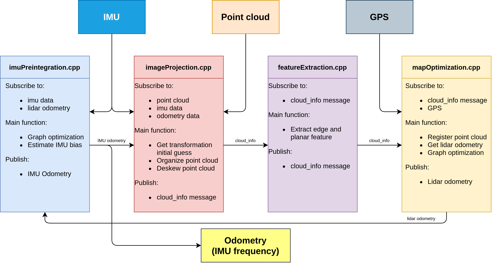
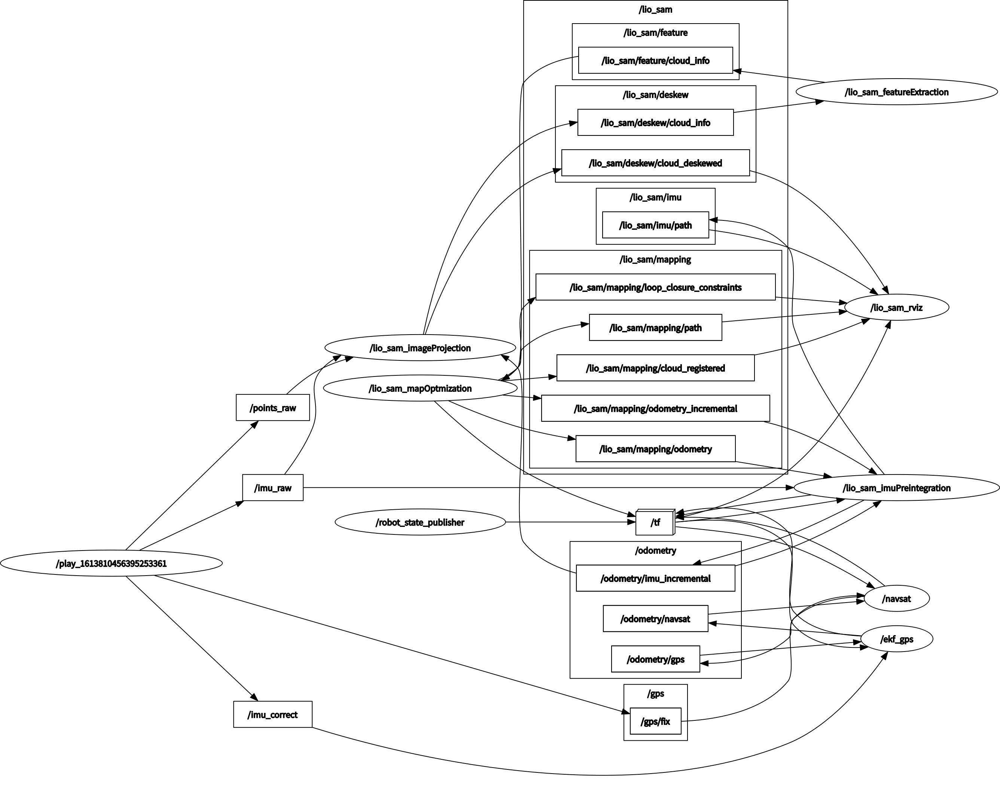

# liosam_liauto

<p align="center">
  
</p>

<p align="center">
  <a href="README.md"></a>
  <a href="https://github.com/1475015695/liosam_liauto/stargazers"></a>
  <a href="https://github.com/1475015695/liosam_liauto/network/members"></a>
</p>

中文说明：本项目实现了在已有点云地图上的重定位与全局实时定位，整体框架基于 LIO-SAM 扩展，并结合车道地图（Lanelet2）做全局定位与在线跟踪。

项目主要目标：
- 在已构建的高精度点云地图中完成全局重定位
- 结合路网/车道地图实现更稳健的全局定位
- 在地图中持续输出实时位姿，用于自动驾驶/机器人场景

## 项目概览

本仓库基于 LIO-SAM 的点云地图建图与定位能力，扩展了以下关键能力：

- 基于 LiDAR + IMU 的地图构建
- 基于点云地图的重定位（relocalization）
- 基于车道地图的全局定位辅助
- 对实时位姿输出与地图中的状态跟踪

<p align="center">
  
</p>

## 功能特点

- 单机/ROS 工作流兼容，适合常见自动驾驶/SLAM 实验环境
- 支持使用已有点云地图进行重定位
- 支持 Lanelet2 路网地图加载与融合
- 实时输出当前位姿，可用于导航、定位反馈和调试
- 提供示例数据包和参考结构，便于复现实验

## 系统要求

- Ubuntu 18.04（已测试）
- ROS Melodic（已测试）
- C++ / ROS 构建环境
- GTSAM
- Lanelet2

## 快速开始

### 1. 下载代码

将仓库克隆到你的 ROS 工作空间：

```bash
cd path/to/your/ros_workspace
git clone https://github.com/1475015695/liosam_liauto.git
```

### 2. 安装依赖

安装 ROS 相关依赖：

```bash
sudo apt-get install -y ros-melodic-navigation
sudo apt-get install -y ros-melodic-robot-localization
sudo apt-get install -y ros-melodic-robot-state-publisher
sudo apt install ros-melodic-lanelet2
```

安装 GTSAM：

```bash
sudo add-apt-repository ppa:borglab/gtsam-release-4.0
sudo apt install libgtsam-dev libgtsam-unstable-dev
```

### 3. 编译

在工作空间根目录执行：

```bash
cd ..
catkin_make
```

如果没有报错，建议执行：

```bash
source devel/setup.bash
```

这样系统就能找到本仓库生成的可执行程序。

## 使用方法

### 1. 准备地图

与 LIO-SAM 类似，构建地图需要使用 LiDAR、IMU 和 GPS（GPS 可选）。

作者提供了一个示例 ROS bag，可用于测试：

- [示例 ros bag（百度网盘）](https://pan.baidu.com/s/1Ie9cqvAPQS5xkZcQsWSOOQ?pwd=auto)

编辑 `config/params.yaml` 中的地图保存目录：

```yaml
savePCDDirectory: "mapDir"
```

然后运行：

```bash
# 终端 1
roslaunch lio_sam run_ori.launch

# 终端 2
rosbag play path/to/your/rosbag.bag
```

播放结束后，按 `Ctrl + C` 停止 `roslaunch`。随后查看 `/home/mapDir`，你会看到多个 `.pcd` 文件：

```text
-mapDir
--CornerMap.pcd                        # 全部角点云
--GlobalMap.pcd                        # 全部表面点和角点
--SurfMap.pcd                          # 全部表面点云
--trajectory.pcd                       # 运动轨迹
--transformations.pcd                  # 坐标转换信息
--cornerVector.pcd                     # 重定位使用的关键角点帧
--surfVector.pcd                       # 重定位使用的关键表面帧
--gpsPoints                            # 重定位使用的 GPS 点
```

注意：建议在生成最终地图后保留一份备份，因为每次运行都会覆盖当前地图。

### 2. 绘制并加载道路地图

道路地图使用 Lanelet2 格式。可参考作者提供的视频：

- [Lanelet2 地图生成视频](https://www.bilibili.com/video/BV1Ku411f7xi/?spm_id_from=333.999.0.0&vd_source=ce887b89ae7b1d3754fb211f66301532)

在 `params.yaml` 中配置路网路径：

```yaml
laneletFilePath: "/roscode/map_copy/new_lanelet2_maps.osm"
```

确认配置正确后，启动：

```bash
roslaunch lio_sam liauto.launch
```

若能看到白色点云地图和红色车道地图，则说明配置正常。

### 3. 重定位（Relocalization）

如果要使用自己的地图，需要编辑 `params.yaml` 中的 `initial_GPS_lat` 与 `initial_GPS_lon`。

随后连接传感器并运行：

```bash
roslaunch lio_sam liauto.launch
```

系统会基于当前 GPS 信息进行重定位。若已知大致位置，也可在 RViz 中使用 “2D Pose Estimate” 手动标注初始位置。

### 4. 实时定位（Realtime Localization）

重定位完成后，`liauto` 会持续跟踪当前位置，并在终端输出坐标。也可以从 `/currPose` 话题获取当前位姿消息。

## 关键文件说明

```text
.
├── config/                 # 参数配置文件
├── launch/                 # ROS launch 文件
├── src/                    # 核心实现代码
├── include/                # 头文件
├── msg/                    # 自定义消息
├── srv/                    # 自定义服务
├── CMakeLists.txt          # 编译配置
├── package.xml             # ROS 包说明
├── README.md               # 英文说明
├── README.zh-CN.md         # 中文说明
├── system.png              # 系统结构图
├── rosgraph.png            # ROS 图
├── factor.png              # 因子图示意
└── LICENSE                 # 许可证
```

## 参考资料

1. [LiDAR_IMU_Init](https://github.com/hku-mars/LiDAR_IMU_Init)  
   激光雷达和 IMU 标定工具，感谢 Fangcheng Zhu、Yunfan Ren、Wei Xu、Yixi Cai 等贡献者。

2. [LIO-SAM](https://github.com/TixiaoShan/LIO-SAM)  
   本项目的基础框架，感谢 TixiaoShan。

3. [Lanelet2](https://github.com/fzi-forschungszentrum-informatik/Lanelet2)  
   车道地图加载与路网使用工具。

4. [LIO-SAM-DetailedNote](https://github.com/smilefacehh/LIO-SAM-DetailedNote)  
   LIO-SAM 详细解读，感谢 smilefacehh、Tao Lu。

5. [我的论文](https://pan.baidu.com/s/1N4BHll2LxmXUIf_olci_WA)  
   提取码：1234，论文中包含详细原理介绍。

## 备注

- 该项目是一个基于 LIO-SAM 的研究/实验型仓库，适合学习点云地图定位、重定位和全局定位相关方法。
- 如果你希望用于自己的数据集，需要根据实际传感器、地图和 GPS 参数自行调整配置。
- 如果你在部署或调试中遇到问题，可以先检查 `config/params.yaml` 和 ROS topic / 系统环境是否匹配。

---

如果你愿意，我还可以继续为这个项目补一版更偏“科研论文风格”的 README，或者再补一个更简介的英文/中文双语首页版本。